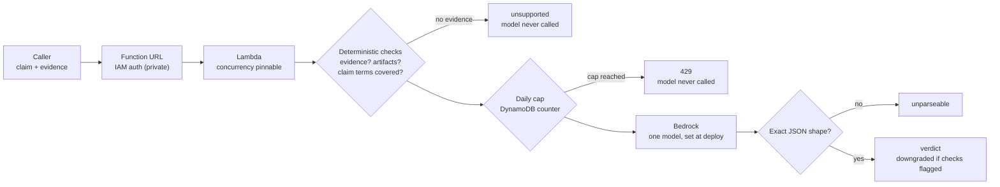

# Bedrock done-claim checker: a small harness around one model

Send a claim that some work is done plus the evidence for it; get back `supported`, `partial`,
`unsupported` or `unparseable`. The point is the harness, not the model:

| Harness part | Where |
|---|---|
| Daily call cap checked **before** Bedrock is called (DynamoDB counter, 429 past the cap) | `src/handler.py` `take_budget` |
| Size limits on input, fixed max output tokens | `MAX_CLAIM`, `MAX_EVIDENCE`, `MAX_TOKENS` |
| Deterministic checks first: no evidence, no concrete artifact, claim terms missing from evidence | `deterministic_checks` |
| One model, chosen at deploy time; no routing between models | `ModelId` parameter |
| Model output accepted only in the exact JSON shape; anything else is `unparseable` | `parse_model_reply` |
| A "supported" from the model is downgraded to `partial` when the checks flagged something | `check` |
| Concurrency pinnable (`ReservedConcurrency`, off by default: new AWS accounts allow only 10 concurrent executions and keep all 10 unreserved); IAM role can invoke exactly one model | `bedrock-harness-demo.yaml` |
| Function URL private (IAM auth) by default | `UrlAuthType` |

## Flow


## Run
```bash
./preflight.sh   # one tiny call: can this account reach the model at all?
./deploy.sh      # stack + code upload (private URL)
./invoke.sh      # one weak claim, one strong claim
./teardown.sh    # delete everything and prove it is gone
```
Defaults: `us-east-1`, `amazon.nova-micro-v1:0`, 100 model calls per day.

## Status
First live run 2026-10-27 (us-east-1, `amazon.nova-micro-v1:0`, private IAM-auth URL; run from CloudShell, no access keys):

| Check | Result |
|---|---|
| Unsigned request to the function URL | 403 |
| Weak claim (no artifacts in evidence) | `unsupported` |
| Strong claim (hash, test output, timestamp) | `partial` on the first run, then `supported` after a fix (below) |
| Daily counter after the run | 5, matching the 5 model calls made |

What the live run found, both fixed:
1. **New AWS accounts can't pin Lambda concurrency.** Their total limit is 10, and Lambda keeps all 10 unreserved, so `ReservedConcurrentExecutions: 1` failed the stack. Pinning is now an opt-in parameter (`ReservedConcurrency`, default 0); the daily cap still bounds spend.
2. **The deterministic word check was too literal.** It flagged "deployed" and "tests" as missing from evidence that said "deploy" and "pytest", and downgraded a claim the model had right. Claim words are now stemmed, with a regression test.

Offline: `cfn-lint` clean, 11 unit tests pass (`python3 -m unittest discover -s tests`). This is a small two-claim smoke test, not an accuracy benchmark.

Independent project by CloudLab Works; not affiliated with or endorsed by AWS.

MIT licensed.
