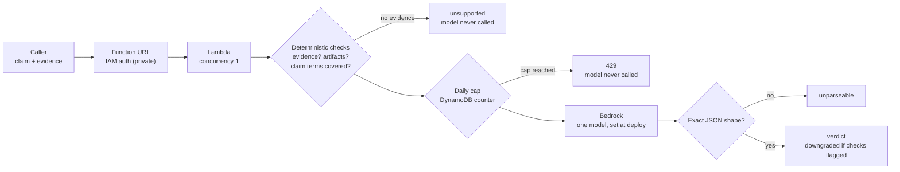

# Bedrock done-claim checker: a small harness around one model

Send a claim that some work is done plus the evidence for it; get back `supported`, `partial`,
`unsupported` or `unparseable`. The point is the harness, not the model:

| Harness part | Where |
|---|---|
| Daily call cap checked **before** Bedrock is called (DynamoDB counter, 429 past the cap) | `src/handler.py` `take_budget` |
| Size limits on input, fixed max output tokens | `MAX_CLAIM`, `MAX_EVIDENCE`, `MAX_TOKENS` |
| Deterministic checks first: no evidence, no concrete artifact, claim terms missing from evidence | `deterministic_checks` |
| One model, chosen at deploy time; no routing between models | `ModelId` parameter |
| Model output accepted only in the exact JSON shape; anything else is `unparseable` | `parse_model_reply` |
| A "supported" from the model is downgraded to `partial` when the checks flagged something | `check` |
| Concurrency pinned to 1; IAM role can invoke exactly one model | `bedrock-harness-demo.yaml` |
| Function URL private (IAM auth) by default | `UrlAuthType` |

## Flow


## Run
```bash
./preflight.sh   # one tiny call: can this account reach the model at all?
./deploy.sh      # stack + code upload (private URL)
./invoke.sh      # one weak claim, one strong claim
./teardown.sh    # delete everything and prove it is gone
```
Defaults: `us-east-1`, `amazon.nova-micro-v1:0`, 100 model calls per day.

## Status
Offline checks only so far: `cfn-lint` clean and 10 unit tests pass (`python3 -m unittest discover -s tests`).
Not yet run against a live AWS account.

Independent project by Cloud Lab Works; not affiliated with or endorsed by AWS.

MIT licensed.
